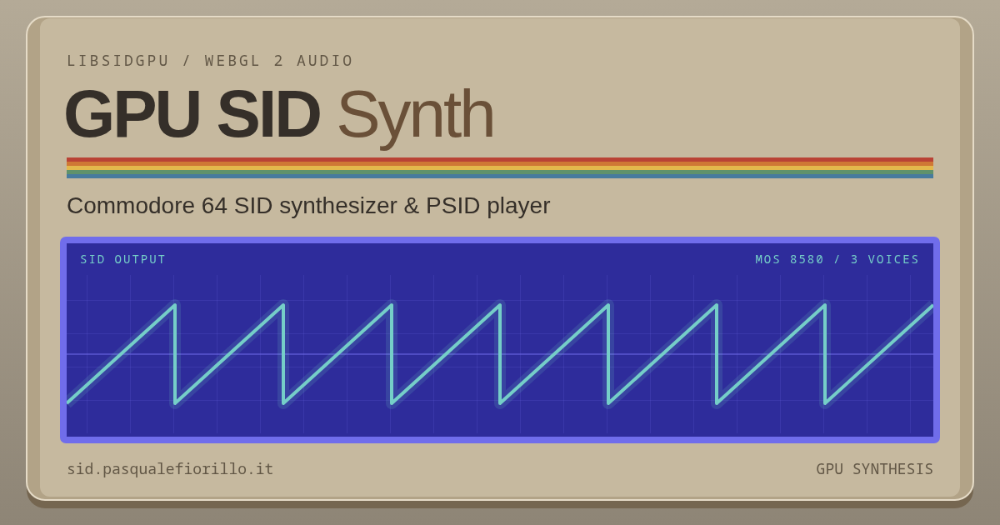

# libsidgpu

`libsidgpu` is a GPU synthesizer modeled after the Commodore 64 MOS 8580 SID chip.

The synthesis core is written in GLSL and runs as fragment passes on WebGL 2 / OpenGL ES 3.0 or as a compute shader on Vulkan 1.0. Each of the three voices pairs a 24-bit phase accumulator (triangle, sawtooth, variable-width pulse, and LFSR noise waveforms, with hard sync and ring modulation) with an ADSR envelope generator, routed into a shared multimode resonant filter.

## Why It Exists

Sound chip synthesis is an inherently sequential problem: LFSR noise shifts, cross-voice hard sync, ADSR envelopes, and the resonant filter's feedback loop each depend on the state produced by the previous sample. GPUs are built for the opposite model, where shader invocations run in parallel without sharing sample-to-sample history.

`libsidgpu` explores how to map a MOS 8580 synthesizer onto standard graphics and compute pipelines by splitting each audio block into short checkpointed segments: a state pass advances the chip state from checkpoint to checkpoint, and a parallel pass renders the PCM samples of each segment at the same time.

Any modern CPU can emulate a 1 MHz chip from 1985 in its sleep, and offloading three 8-bit voices to a graphics card solves no practical problem whatsoever. Making the GPU render Commodore 64 audio is completely unnecessary, which is the best reason to do it properly.

## Hosts

### WebGL 2 (TypeScript)

The [hosts/webgl](hosts/webgl/README.md) workspace builds the `libsidgpu` npm package for WebGL 2 contexts (`HTMLCanvasElement` or `OffscreenCanvas`). Building requires Node.js 22.12+:

```sh
npm ci
npm run build
```

[examples/web-synth](examples/web-synth/README.md) is a browser synthesizer and `.sid` (PSID) player built on top of `libsidgpu` (requires WebGL 2 and AudioWorklet support), with a live demo at [sid.pasqualefiorillo.it](https://sid.pasqualefiorillo.it):

[](https://sid.pasqualefiorillo.it)

To run it locally:

```sh
npm run dev
```

Open `http://127.0.0.1:5180` to play from the keyboard or load a PSID file. Use `npm run build:demo` and `npm run preview` for a static production build.

### OpenGL ES and Vulkan (C)

The C hosts in [hosts/opengles](hosts/opengles/README.md) and [hosts/vulkan](hosts/vulkan/README.md) expose the same synchronous [C API](docs/c-api.md) (`hosts/include/sidgpu.h`) and build `libsidgpu.so`.

Building requires a C99 compiler and CMake 3.19+. The OpenGL ES host uses `pkg-config` to locate EGL and OpenGL ES 3; the Vulkan host requires the Vulkan loader, headers, and `glslangValidator`.

```sh
make
hosts/vulkan/build/examples/vulkan-wav/sidgpu-wav /tmp/tone.wav
```

`make opengles` and `make vulkan` build either backend individually.

## Tests

```sh
npm test
npx playwright install chromium
npm run test:browser -- --headed
make test
```

## Layout and Documentation

```text
docs/                   API references, GPU formats and synthesis model
shaders/                GLSL synthesis core, OpenGL ES fragment passes, Vulkan compute shader
hosts/
  include/sidgpu.h      Public C header
  common/               Event queue shared by the C hosts
  opengles/             OpenGL ES 3.0 C host
  vulkan/               Vulkan 1.0 compute C host
  webgl/                WebGL 2 TypeScript package (libsidgpu)
  metal/                Design notes for a Metal compute host (not implemented yet)
examples/
  web-synth/            Browser synthesizer and PSID player
  opengles-wav/         Command-line WAV renderer using EGL + OpenGL ES
  vulkan-wav/           Command-line WAV renderer using Vulkan
tests/
  hosts/                CTest suite for the native hosts
  reference/            reSID digital reference vectors
```

API references and technical documentation:

- [WebGL 2 API](docs/webgl-api.md) for JavaScript and TypeScript applications
- [C API](docs/c-api.md) shared by OpenGL ES and Vulkan
- [Shader Interface](docs/shader-api.md) and [GPU Formats](docs/gpu-formats.md)
- [Synthesis Model and Limitations](docs/limitations.md)
- [Validation](docs/validation.md)

## License

libsidgpu is free software released under the [MIT License](LICENSE).

Copyright (c) 2026 Pasquale 'sid' Fiorillo.

Third-party components retain their own licenses. The web demo's notices are included in [third-party-notices.txt](examples/web-synth/public/third-party-notices.txt).
